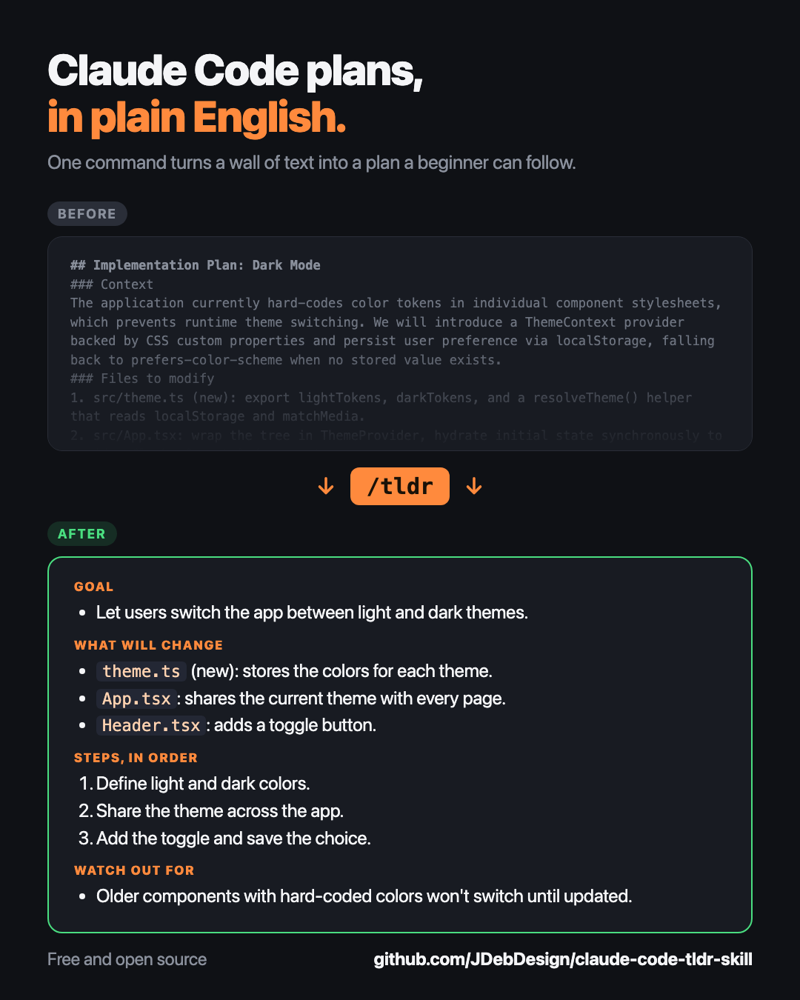

# /tldr: a Claude Code skill that explains plans in plain English

Claude Code's plans can be long, technical, and hard to scan. `/tldr` turns any plan into a short bullet list that a beginner developer can read in under a minute.

<p align="center">
  
</p>

## What you get

After Claude Code writes a plan, type `/tldr` and you get:

- **Goal**: what we are trying to achieve, in one bullet
- **What will change**: the files and features that get added, edited, or removed
- **Steps, in order**: a short numbered list
- **Watch out for**: risks and open decisions (only if there are any)

Technical terms get a short explanation in parentheses, so you do not have to look things up.

## Example

Given a plan that proposes adding dark mode to a React app, `/tldr` returns something like:

```
**Goal**
- Let users switch the app between light and dark themes.

**What will change**
- `theme.ts` (new): stores the color values for each theme.
- `App.tsx`: wraps the app so every page can read the current theme.
- `Header.tsx`: adds a toggle button to switch themes.
- `localStorage` (the browser's small built-in storage): remembers the choice between visits.

**Steps, in order**
1. Define light and dark color sets in `theme.ts`.
2. Add a theme provider (a component that shares data with all its children) in `App.tsx`.
3. Build the toggle button in `Header.tsx`.
4. Save and load the choice from `localStorage`.
5. Check every page in both themes.

**Watch out for**
- Hard-coded colors in older components will not change until they are updated.
```

## Install

This is a personal skill, so install it once and it works in every project.

```bash
git clone https://github.com/JDebDesign/claude-code-tldr-skill.git
mkdir -p ~/.claude/skills
cp -R claude-code-tldr-skill/tldr ~/.claude/skills/tldr
```

Start a new Claude Code session so it picks the skill up.

To use it in a single project only, copy the `tldr` folder into that project's `.claude/skills/` folder instead.

## Use

1. Ask Claude Code to make a plan (plan mode works great for this).
2. Type `/tldr`.

Options:

- `/tldr` summarizes the most recent plan in the conversation.
- `/tldr path/to/plan.md` summarizes a specific plan file.

Anything you type after `/tldr` is treated as a hint, so you can steer the summary:

- `/tldr risks only` or `/tldr just the steps` returns only that section.
- `/tldr explain it like I'm new to React` adjusts the wording for your level.
- `/tldr will this touch the database?` makes sure that question is answered.
- `/tldr in 3 bullets` or `/tldr in Spanish` changes the length or language.

Hints change emphasis and wording only. The skill still sticks to what the plan says and never edits anything.

If the conversation has no plan, it falls back to the newest file in `~/.claude/plans/` and tells you which file it used.

## Good to know

- It is read-only. It never edits files, runs the plan, or exits plan mode.
- It only summarizes what the plan says. It will not add steps or change scope.
- Want a different length or tone? Open `tldr/SKILL.md`. It is a short, plain-text file, and the rules at the bottom are easy to tweak.

## License

MIT. See [LICENSE](LICENSE).
